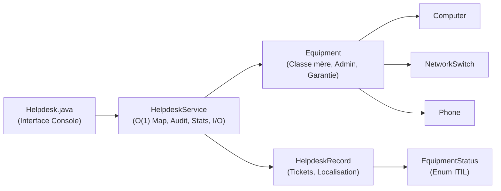

###### README.md >> markdown
---
```markdown
💡 Rappel rapide avant git push : vérifie que ton .gitignore à la racine contient bien bin/, bin-test/, *.class, *.tmp, *.bak et que le fichier dans model/ s'appelle bien NetworkSwitch.java (sans faute de frappe). Si tu veux, je peux aussi te générer le contenu exact du .gitignore ou de Docs/structure.md !
```

---

<a id="top"></a>
<div align="center">

# 🛠️ helpDeskJAVA
### Gestion de Parc Informatique (ITAM) & Support Helpdesk en Java

Application console modulaire, sécurisée et sans dépendance externe pour inventorier les équipements IT, suivre les tickets d'incidents et piloter la conformité du parc.

<br/>

<!-- Badges Statut & Version (Vert & Rouge) -->


<!-- Badges Dynamiques GitHub Shields.io (Vert & Rouge) -->
[](https://github.com/teremuhamblin/helpDeskJAVA/commits)
[](https://github.com/teremuhamblin/helpDeskJAVA)
[](https://github.com/teremuhamblin/helpDeskJAVA)
[](https://github.com/teremuhamblin/helpDeskJAVA/issues)
[](LICENSE)

<br/>

[🚀 Démarrage rapide](#demarrage) • [🏗️ Architecture](#architecture) • [✨ Nouveautés v1.2](#nouveautes) • [🛡️ Sécurité](#securite) • [🧪 Tests](#tests) • [📋 Guide Menu](#menu)

</div>

---

<a id="sommaire"></a>
## 🧭 Sommaire opérationnel

| Section | Objectif | Accès direct |
| :--- | :--- | :--- |
| **1. Présentation & Nouveautés** | Périmètre ITAM/ITIL et apports de la v1.2 Stable | [Voir](#nouveautes) |
| **2. Architecture & Arborescence** | Couches `model/`, `service/`, CLI et diagramme Mermaid | [Voir](#architecture) |
| **3. Démarrage rapide** | Cloner, compiler et exécuter en 30 secondes | [Voir](#demarrage) |
| **4. Tests unitaires** | Exécution de la suite `HelpdeskTest` | [Voir](#tests) |
| **5. Fonctionnalités & Menu** | Capacités par équipement et guide des 13 actions | [Voir](#menu) |
| **6. Sécurité & Persistance** | Durcissement anti-injection, sauvegardes atomiques, rétrocompatibilité | [Voir](#securite) |
| **7. Licence** | Conditions d'utilisation (MIT) | [Voir](#licence) |

---

<a id="nouveautes"></a>
## ✨ Présentation & Nouveautés v1.2 Stable

**helpDeskJAVA** centralise l'inventaire matériel (**Ordinateurs**, **Commutateurs réseau**, **Téléphones**), le suivi administratif (garanties, fournisseurs, valeur HT en `BigDecimal`) et le support Helpdesk (affectation, statuts ITIL, tickets datés, audits et exports).

> [!IMPORTANT]
> **Ce qui change en v1.2 Stable :** refonte complète en architecture en couches standard (`src/main/java/` & `src/test/java/`), standardisation du code en anglais, passage de la recherche par SN en **`O(1)`**, ajout du **Pattern Builder**, précision financière **`BigDecimal`**, durcissement de sécurité renforcé et **rétrocompatibilité 100 % assurée** avec les sauvegardes v1.0 / v1.1.

<details>
<summary><b>📦 Détail des améliorations techniques v1.2 (cliquer pour déplier)</b></summary>

* **Architecture modulaire :** séparation stricte entre `model/` (entités & validations), `service/` (logique métier & I/O sans dépendance `Scanner`) et `Helpdesk.java` (interface CLI).
* **Performance :** indexation par `LinkedHashMap<Integer, Equipment>` (`O(1)`), regex `Pattern` pré-compilées, types primitifs `int`, nettoyage de texte en une passe `O(n)` via `StringBuilder`.
* **Ergonomie :** ajout des constructeurs fluides `Computer.builder(...)`, `NetworkSwitch.builder(...)` et `Phone.builder(...)`.
* **Fiabilité :** `serialNumber` immuable (`final`), égalité symétrique par classe, calcul de garantie déterministe (`isUnderWarranty(LocalDate)`).

</details>

---

<a id="architecture"></a>
## 🏗️ Architecture & Structure du projet



```text
helpDeskJAVA/
├── .gitignore
├── README.md
├── LICENSE
├── Docs/
│   └── structure.md
├── src/
│   ├── main/java/
│   │   ├── README.md
│   │   ├── CONSEILS_JAVA.md
│   │   ├── Helpdesk.java                 # Point d'entrée CLI (menus & saisie sécurisée)
│   │   ├── model/
│   │   │   ├── Equipment.java            # Base commune (SN immuable, BigDecimal, garantie)
│   │   │   ├── Computer.java             # Postes (OS, CPU, RAM, MAC, BitLocker/EDR)
│   │   │   ├── NetworkSwitch.java        # Switchs (ports, PoE, IPv4 stricte, VLAN)
│   │   │   ├── Phone.java                # Téléphones (ligne, IMEI/Luhn, masquage PII, MDM)
│   │   │   ├── EquipmentStatus.java      # Statuts ITIL (IN_STOCK, IN_USE, BROKEN...)
│   │   │   └── HelpdeskRecord.java       # Fiche Helpdesk & historique de tickets
│   │   └── service/
│   │       └── HelpdeskService.java      # Cœur métier, audit, KPI, import/export atomique
│   └── test/java/
│       └── HelpdeskTest.java             # Suite de tests unitaires (zéro dépendance)
├── bin/                                  # Généré automatiquement par javac -d (ignoré par Git)
└── bin-test/                             # Généré automatiquement pour les tests (ignoré par Git)
```

> [!TIP]
> Les dossiers `bin/` et `bin-test/` sont **créés automatiquement** lors de la compilation (`javac -d`). Le dossier `lib/` n'est requis que si vous ajoutez ultérieurement des `.jar` externes.

---

<a id="demarrage"></a>
## 🚀 Démarrage rapide

### Prérequis
* **Java JDK 11+** (JDK 17 ou 21 LTS recommandé — compatible JDK 8+)
* **Git**

### Installation, compilation & lancement

```bash
# 1. Cloner le dépôt
git clone https://github.com/teremuhamblin/helpDeskJAVA.git
cd helpDeskJAVA

# 2. Compiler les sources vers bin/ (création automatique de bin/)
javac -encoding UTF-8 -d bin src/main/java/model/*.java src/main/java/service/*.java src/main/java/*.java

# 3. Lancer l'application
java -cp bin Helpdesk
```

---

<a id="tests"></a>
## 🧪 Tests unitaires

Une suite de tests autonome (`HelpdeskTest.java`) valide la création via Builders, les normalisations, l'algorithme de Luhn (IMEI), la gestion des tickets et le rejet des entrées invalides :

```bash
# Compiler les tests dans bin-test/
javac -encoding UTF-8 -cp bin -d bin-test src/test/java/HelpdeskTest.java

# Exécuter sous Linux / macOS
java -cp "bin:bin-test" HelpdeskTest

# Exécuter sous Windows (CMD / PowerShell)
java -cp "bin;bin-test" HelpdeskTest
```

---

<a id="menu"></a>
## 📋 Fonctionnalités & Guide du menu

| Domaine | Capacités principales en v1.2 |
| :--- | :--- |
| **Ordinateurs** | OS, CPU, RAM (1–4096 Go), GPU, stockage, hostname RFC, MAC normalisée, chiffrement disque & EDR/AV |
| **Commutateurs** | Ports (1–512), allocation/libération sécurisée, taux d'occupation, PoE, L2/L3, IPv4 stricte/DHCP, VLAN 802.1Q |
| **Téléphones** | OS, marque, modèle, numéro de ligne (≥ 3 chiffres), IMEI 15 chiffres + contrôle Luhn, masquage PII, statut MDM |
| **Helpdesk & Audit** | Statuts ITIL, affectation, tickets datés, alertes garantie (< 30 j), saturation switch (≥ 85 %), conformité cyber |
| **Dashboard & Exports** | Valorisation HT (`BigDecimal`), KPI par type/statut, sauvegarde UTF-8, fusion/remplacement, rapport Excel CSV |

<details>
<summary><b>⌨️ Consulter les 13 commandes du menu console (0 à 12)</b></summary>

| Touche | Action | Description |
| :---: | :--- | :--- |
| `1` | Renommer le parc | Modifie le nom du parc informatique |
| `2` | Ajouter un matériel | Assistant guidé pour `Computer`, `NetworkSwitch` ou `Phone` + admin/Helpdesk |
| `3` | Mettre à jour | Édition ciblée des champs Helpdesk, administratifs, garantie ou techniques |
| `4` | Ajouter un ticket | Enregistre une intervention horodatée (avec passage optionnel en panne) |
| `5` | Supprimer / réformer | Suppression par SN après confirmation explicite |
| `6` | Afficher le parc | Liste complète triée par numéro de série (`Comparable<Equipment>`) |
| `7` | Rechercher | Par SN (avec historique tickets), type (alias FR/EN), statut, utilisateur ou mot-clé |
| `8` | Audit & alertes | Détecte garanties expirées/proches, postes non conformes, téléphones hors MDM, switchs saturés |
| `9` | Tableau de bord | Statistiques globales, répartition et valorisation financière HT |
| `10` | Exporter le parc | Sauvegarde structurée UTF-8 dans `parc_helpdesk.txt` |
| `11` | Importer un parc | Charge un fichier v1.0 / v1.1 / v1.2 (remplacement ou fusion sans écrasement) |
| `12` | Exporter rapport CSV | Génère `parc_rapport.csv` avec BOM UTF-8 pour Excel |
| `0` | Quitter | Fermeture sécurisée après confirmation |

</details>

---

<a id="securite"></a>
## 🛡️ Sécurité, Fiabilité & Persistance

| Menace / Risque | Protection implémentée en v1.2 Stable |
| :--- | :--- |
| **Désérialisation non sûre** | Aucun `ObjectInputStream` : format texte UTF-8 explicite et vérifié ligne par ligne |
| **Path Traversal** | Validation stricte du nom de fichier (`[a-zA-Z0-9_.-]+`), blocage de `.`, `..`, répertoires et sortie du dossier |
| **Corruption de sauvegarde** | Écriture atomique via fichier temporaire `.tmp`, sauvegarde préalable `.bak` et nettoyage garanti en `finally` |
| **DoS / Fichier massif** | Taille maximale d'import plafonnée à **10 Mo** et longueur des champs texte bornée (`MAX_TEXT_LENGTH = 120`) |
| **Injection CSV / Terminal** | Neutralisation des formules tableur (`=`, `+`, `-`, `@`), échappement `;`/`|` et filtrage des caractères de contrôle ISO |
| **Données invalides / PII** | Regex pré-compilées (IPv4 sans zéro octal ambigu, MAC, hostname, IMEI), masquage IMEI (`getMaskedImei()`) dans les logs |
| **Dérive financière & clés** | `BigDecimal` (`RoundingMode.HALF_UP`) pour les prix, `serialNumber` immuable (`final`) pour protéger les `Map`/`Set` |

> [!NOTE]
> **Rétrocompatibilité garantie :** l'importateur v1.2 lit nativement les fichiers générés par les versions **v1.0 et v1.1** (`Ordinateur`, `Commutateur`, `Telephone`, anciens statuts ITIL français et libellés `"Non renseigné"`).

---

<a id="licence"></a>
## 📄 Licence

Ce projet est distribué sous licence **MIT**. Consultez le fichier [`LICENSE`](LICENSE) pour plus de détails.

---

<div align="center">

Fait avec ☕ en **Java** • **v1.2 Stable** • [⬆️ Retour en haut](#top)

</div>

